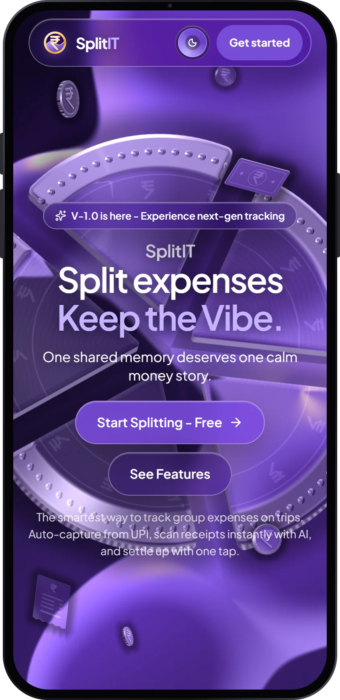
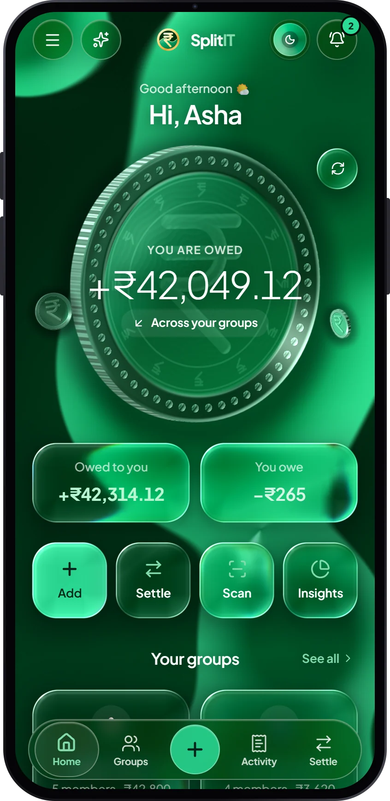
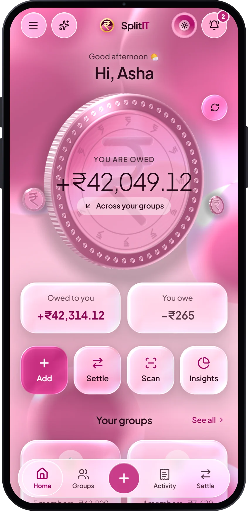
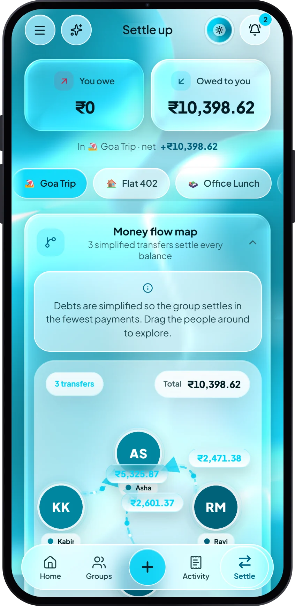
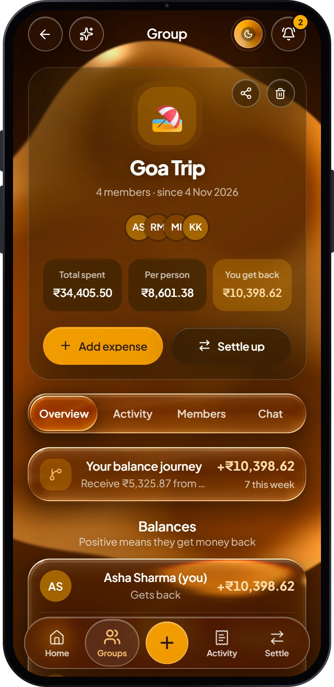
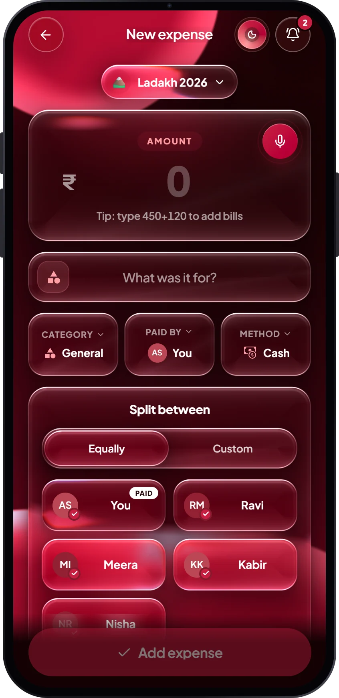
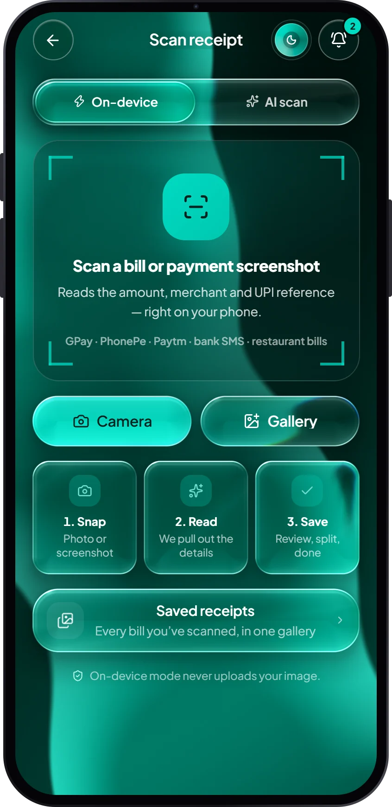
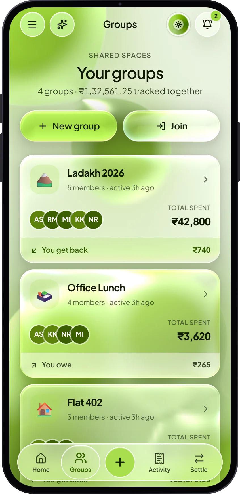
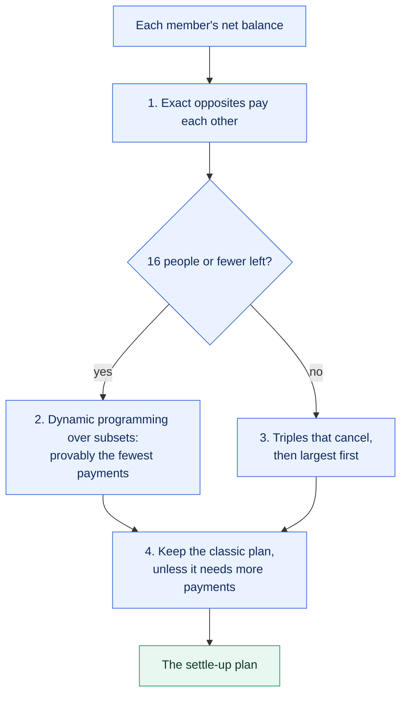

<div align="center">

# SplitIT

**A mobile-first app to split expenses with friends, on the web and on your phone.**

[](https://github.com/Sayandip-Jana-1018/SplitX/actions/workflows/ci.yml)
[](https://github.com/Sayandip-Jana-1018/SplitX/actions/workflows/codeql.yml)
[](https://sonarcloud.io/summary/new_code?id=Sayandip-Jana-1018_SplitX)
[](https://splitsj.vercel.app)
[](https://github.com/Sayandip-Jana-1018/SplitX/actions/workflows/uptime.yml)

[**The live app**](https://splitsj.vercel.app) · [**The phone app's roadmap**](docs/mobile/ROADMAP.md) · [**Every decision**](docs/DECISIONS.md) · [**The DevOps project, as submitted**](https://github.com/Sayandip-Jana-1018/SplitIT/tree/devops-submission)

<br/>





<br/>





<br/>

**Mobile-first, in Liquid Glass.** Designed for your phone, in 16 colours and 5 kinds of glass, dark and light.<br/>
Install it from your browser today. Play Store and App Store apps are on the way.

</div>

---

## Contents

- [What SplitIT is](#what-splitit-is)
- [The app](#the-app)
- [Run it](#run-it)
- [Where things are](#where-things-are)

---

## What SplitIT is

**A mobile-first expense-splitting app**, designed for your phone and installable from the browser
today, with Play Store and App Store apps [on the way](docs/mobile/ROADMAP.md). You record who paid for what
in groups and trips, and it settles everyone up in the fewest payments, with UPI links. Its Liquid Glass
design is drawn by a WebGL engine of its own, with coins that turn and split. It is built with Next.js 16,
Prisma on Neon Postgres, and NextAuth v5, and it is live on Vercel for real users.

**A phone app** (`apps/mobile`, Expo and React Native) uses the same accounts and data through `/api/v1`.
It works offline, sends what you changed once it is back online, and draws its glass with Skia.

**What runs it:** Vercel, Neon Postgres, Upstash Redis for rate limits, and Supabase Storage for photos.
Every push is checked by CI (types, lint, unit tests, a real Postgres and Redis, browser tests on a
production build, a secret scan, CodeQL and SonarQube Cloud), and the live site is checked every 15 minutes.

**How it began:** as a DevOps course project, with the same app on Kubernetes (Kind, and AWS EKS on demo
days), delivered by Jenkins from signed releases, watched by Prometheus and Grafana, with a control room
at `/ops`. It was submitted and signed off in October 2026. That platform is kept exactly as submitted at
the tag [`devops-submission`](https://github.com/Sayandip-Jana-1018/SplitIT/tree/devops-submission), and
what it measured is in [docs/evidence](docs/evidence/).

Every decision, what was rejected, and the measurement behind each claim is in
**[docs/DECISIONS.md](docs/DECISIONS.md)**: 125 decisions, with the open problems at the end.

---

## The app

- **Groups and trips:** expenses split equally, by percentage, by custom amounts, or item by item from
  a scanned receipt.
- **Settle up:** the fewest payments, with UPI links, and a per-group Balance Journey that explains
  every change.
- **AI, optional:** a Gemini chat assistant that answers from the ledger, and voice entry of expenses.
- **Receipts:** on-device OCR (Tesseract), or OpenAI Vision for itemised receipts. They are stored in
  Supabase Storage, uploaded with signed URLs.
- **Accounts:** email and password, Google, or GitHub. Rate limits are per device, under a
  ceiling per network, so a classroom behind one address isn't refused as one person
  ([D-045](docs/DECISIONS.md), [D-076](docs/DECISIONS.md)).
- **Everywhere:** installable as a PWA, in solid colours and blends, light and dark, built for phones first.
- **`/scale`:** the public demo page from the course. Plan a trip for up to 2,000 people.

### The settlement engine



A group of *k* people whose balances add up to zero settles in *k − 1* payments, so the fewest
payments means the most such sets. A simulated 2,000-person event needs 1,818 payments instead of
1,999; repaying each expense directly would take 23,602 ([D-023](docs/DECISIONS.md)).

---

## Run it

**The app, locally** (Node 24):
```bash
npm ci
```
```bash
cp .env.example .env
```
Then fill in `.env`, and start Postgres and Redis with `docker compose up -d postgres redis`.
```bash
npm run dev
```

**Tests:**
- `npm test`: unit and property tests.
- `npm run test:integration`: against a real Redis.
- `npm run test:db`: against a real Postgres.
- `npx playwright test`: the browser tests, against a running production build (CI's e2e job).

**The phone app:** in `apps/mobile`, `npm ci`, then `npm run phone`.
Its APK is built by the **app-apk** workflow on every push to `feat/app`.

---

## Where things are

| Path | What |
|---|---|
| `src/` | The website: pages, API routes (`/api/v1` is the phone app's), and `src/lib` (the settlement planner, services, rate limiting) |
| `apps/mobile/` | The phone app (Expo, React Native, Skia) |
| `prisma/` | The database schema and its migrations |
| `tests/` | Unit, integration, database and browser tests |
| `scripts/` | The production checks, the database migration and its restore drill, the ledger audit |
| `docs/` | [DECISIONS](docs/DECISIONS.md), the phone app's [roadmap](docs/mobile/ROADMAP.md), and the DevOps project's [runbook](docs/DEMO_DAY.md) and [evidence](docs/evidence/), kept as records |

This project is private and not open-source.
