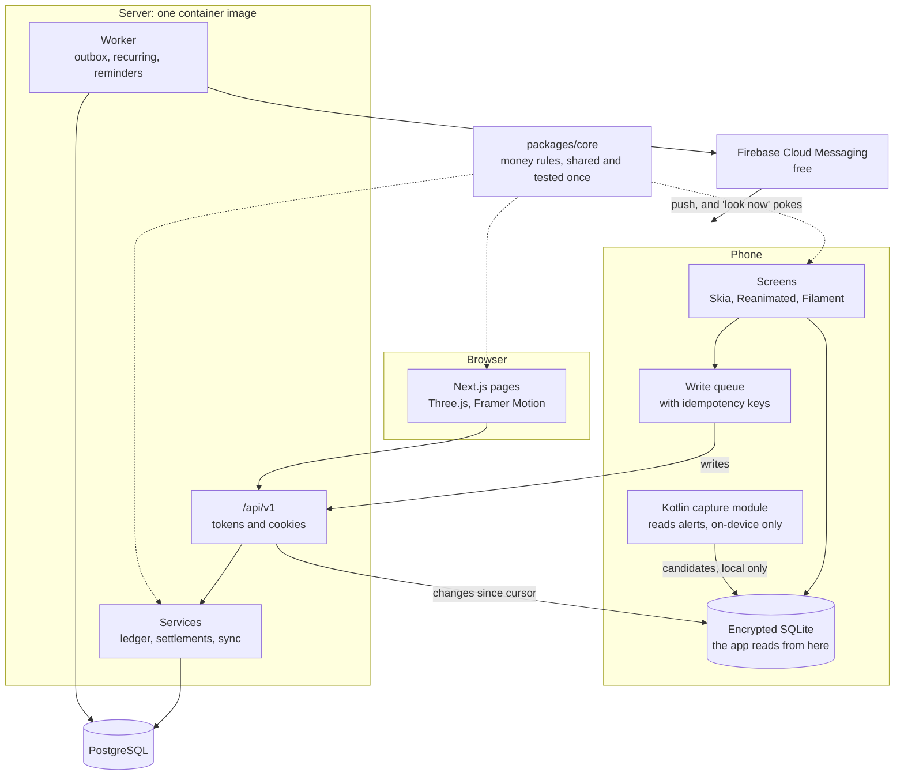
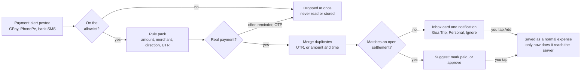

# SplitX app: the roadmap

**Status: paused on 3 November 2026.** The web app gets the Liquid Glass design first ([the overhaul plan](../web/LIQUID_GLASS_OVERHAUL.md)). Nothing here is built. When this resumes, Section 6 must be rewritten: it still describes "Arcade Ledger", which was replaced by Liquid Glass, and the stack needs a line on real-time glass.
**Design boards:** [SplitX Liquid Glass canvas](https://claude.ai/artifact/XSFNfEYYXmoVufit1w6w9B) (private to you).

## 1. The brief, as you decided it

| Question | Your decision |
|---|---|
| Launch | **Build it launch-ready, do not launch now.** It runs at production quality on your computer. |
| Spending | **No server bills now.** Every paid item waits for launch day (section 10). |
| Scope | **The full vision:** full redesign, 3D, auto-capture, offline, push, gamification. |
| Order | **Android first, then iPhone.** |
| Website | **Redesigned alongside the app**, not after it. |
| Money | **Free for now.** A clean place for a Pro plan is left in the design, nothing more. |

I assumed three more things. Tell me if any is wrong:
- **India first:** UPI, rupees, and English at launch. Text is built so Hindi can be added without rework.
- **18 and over:** this avoids the parental consent duty in India's data law.
- **You test on real phones:** no emulator, because of the laptop's cooling.

## 2. What exists, and what has to change

The web app is a strong base. The money engine, tests and decision log are worth keeping. The gaps are nearly all about being a phone app rather than a website.

**Keep:**
- **The money logic.** About 1,500 lines in 11 modules have no framework imports, so they can move into a shared package unchanged: `settlementPlanner`, `groupFinance`, `splits`, `expenseSplits`, `receiptSplit`, `transactionParser`, `upi`, `categoryInference`, `indiaTime`, `settlementStatus`, `utils`.
- **The settlement state machine** (`src/lib/settlementTransitions.ts`), with its race protection and audit log.
- **Integer paise, soft deletes, idempotent expense saves, the rate limiter, and 1,465 tests.**
- **The signed 81 MB container image.** It already runs on Kubernetes, so the backend isn't tied to one host.

**Change:**

| Found in the code | Why it matters for an app | Fix |
|---|---|---|
| 34 API files read a browser cookie session through NextAuth, most then look the user up by email | A phone app has no cookie jar, and placeholder members have no email | One `requireUser()` that accepts cookies and tokens, returning a user ID |
| Only 2 of 49 API routes use the shared response helper; 45 build their own JSON | Old app versions live for years, so the API needs one stable shape | `/api/v1` with a single error format and a written contract |
| Notifications are polled every 30 s and chat every 5 s; there is no push at all | Drains battery, and nothing arrives when the app is closed | Push through Firebase Cloud Messaging |
| The service worker deliberately caches nothing | No offline use, and trips often have poor signal | On-device database and a sync protocol |
| `GroupMember.userId` is required | Everyone must have an account before you can split with them | Placeholder members, claimed later |
| `Transaction.payerId` is a single person | Two people can't both pay for one bill | A payers table |
| Currency lives on the trip, and non-rupee receipts only get a warning | Foreign trips don't work properly | Currency and rate on each expense |
| No recurring expenses | Rent and Wi-Fi are retyped every month | Recurring rules run by a worker |
| The production database is in `us-east-1`, and the first request today took 4.6 s | Fine for a demo, slow for Indian phones | Moved to Mumbai on launch day only |
| Privacy, Terms and Contact footer links go to `#` | Both stores require real ones | Real pages in Phase 7 |
| No restore drill has ever been run; errors reach no one (B-032) | A backup you haven't restored isn't proven | Drill in Phase 2, Sentry's free plan |

**Also found:**
- **The name is taken.** Google Play already has three apps called exactly "SplitX", plus "SplitX: Split Bills & Expenses". The App Store has "SplitX: Bill & Expense Split" and "SplitX - Manage Group Expenses". `splitx.app` and `splitx.in` are registered. See section 12.
- **CI will likely stop at the next push to `main`.** The k6 exceptions in `ops/.trivyignore.yaml` expired on 24 October.
- **Your tools are nearly ready.** Android Studio, Android SDK platforms 33 to 36 and Node 24 are installed. `java` on your PATH is version 8 and `adb` isn't on PATH, so Phase 0 points both at the right versions. Build-tools 36 needs adding.
- **You've used Expo before** (`AudioApp`, Expo 51). Flutter is installed, but I found no Flutter project in your Projects folder.

## 3. Languages and stack

| Layer | Language | Tools |
|---|---|---|
| App screens and logic | **TypeScript** (strict) | React Native 0.88 with Expo SDK 58, Expo Router |
| Animation and effects | TypeScript, plus **SkSL** shaders | Reanimated 4, Gesture Handler, React Native Skia |
| 3D | TypeScript, **glTF** assets from Blender | Filament on the phone, Three.js on the web (Phase 0 confirms Filament) |
| Vector stickers and characters | Rive files | The same files on phone and web |
| Android-only code | **Kotlin** | Notification listener, UPI result handling, quick tile |
| iPhone-only code | **Swift** | Share extension, App Intents |
| Website | TypeScript | The existing Next.js 16, rebuilt screen by screen |
| Backend | TypeScript on Node 24 | The existing Next.js API, Prisma, plus a worker process |
| Database | **SQL** | PostgreSQL on the server, SQLite (encrypted) with Drizzle on the phone |
| Tests | TypeScript, **YAML** | Vitest, fast-check, Playwright, Maestro for phone flows |

**Why React Native with Expo:**
1. **One language across phone, web and server.** The money rules stay in one place with their tests, instead of being rewritten and drifting apart.
2. **iPhone builds without a Mac.** You're on Windows.
3. **It suits your laptop.** Once a development build is on the phone, most changes reload over USB with no native compile, and heavy builds run in the cloud.
4. **Native-quality motion.** Animations run on the UI thread, so a busy app doesn't drop frames during a swipe.

**Why not the others:**
- **Flutter:** excellent for custom visuals, but Dart means rewriting the money logic, and iPhone builds need a Mac or a cloud service. Reasonable, but the wrong trade for this project.
- **Wrapping the website (Capacitor):** fastest, but it can't reach this design's feel on budget phones, and Apple asks for apps to be more than a repackaged website.
- **Separate Kotlin and Swift apps:** the best possible feel, but two full codebases for one person.
- **Rewriting the backend in Go or Java:** throws away 1,465 tests and 117 recorded decisions, and buys nothing this app needs. A backend is strong because it is correct and well operated, not because of its language.

**The honest trade-off:** real-time 3D is React Native's weakest area. So 3D gets its own proof on a budget phone in Phase 0, with pre-rendered art as the planned fallback.

## 4. Architecture

**Repository:** one monorepo, this one, using npm workspaces. `apps/mobile` holds the app. `packages/core`, `packages/contract` and `packages/tokens` hold the shared money rules, API contract and design tokens. `modules/` holds the Kotlin and Swift code. Phase 0 proves this layout before anything depends on it.

**Branch:** all work happens on a long-lived `feat/app` branch, and reaches `main` only when you approve a phase. Vercel deploys `main`, so the live site and its data stay untouched. This replaces the current push-straight-to-main habit for this project only, and needs your OK.

**Three environments, all free until launch:**

| Environment | What runs | How the phone reaches it | Cost |
|---|---|---|---|
| **Laptop** (default) | Production build of the API, the worker, and Postgres on its own port with fake users | USB with `adb reverse`, so no public address and no Wi-Fi setup | ₹0 |
| **Live site** (optional) | Today's site, stays as it is | Over the internet | ₹0 |
| **Production** | Written, scripted and rehearsed, not bought | | Paid from launch day |

No Kubernetes or Docker cluster runs on the laptop. The EKS, Jenkins and Nexus platform stays in the repo as your portfolio piece, with no role in this app's path to launch. If the laptop is off, the app keeps working offline and syncs later. Push needs the laptop on.

## 5. The backend plan

**Design rules:**
- **A modular monolith:** one image, two roles (API and worker), with one service layer. Business logic moves out of route handlers; `transactions/[id]/route.ts` is 427 lines today.
- **The server owns money.** The phone can queue new and edited expenses offline, but settlement moves always need the server, because they re-check balances.
- **Sync is the truth, and a push is only a hint.** Push says "look now", and the phone then asks for changes since its cursor. A lost push costs a delay, never wrong data. This avoids paying for a real-time vendor.
- **Nothing is tied to one host.** Plain Postgres, S3-style file storage and a Postgres-backed job queue, so the launch-day host stays a free choice.

**What gets added:**
- **Mobile sign-in:** a 15-minute access token and a rotating refresh token with reuse detection, kept in the phone's secure storage and tied to the existing `tokenVersion`. Native Google sign-in. Sign in with Apple is written but stays off until there's an Apple account, because Apple requires an equivalent option on iPhone.
- **Push and jobs:** a device table, Firebase, and a transactional outbox, so a notification is saved in the same database transaction as the money change. Retries, per-category preferences, quiet hours, and a "hide amounts" setting.
- **Sync:** client-generated IDs, a `syncSeq` on each synced table, tombstones from the existing soft deletes, and `GET /v1/sync?cursor=`. A version check turns a clash into a clear choice for the user, not a silent overwrite.
- **Control:** remote config, kill switches for capture and heavy visuals, and a minimum-app-version gate.
- **Operations:** Sentry's free plan on phone, web and server (closes B-032), a backup and restore drill, and `ledger:audit` run after every migration.

**Schema changes:** all additive, so the current web app keeps working during the move. `Device`, `RefreshToken`, `OutboxEvent`, `TransactionPayer`, `RecurringRule`, `XpEvent`, `UserBadge`, `QuestProgress`, `ConsentRecord`; `User.isPlaceholder`; `Group.kind` (a private "personal" group keeps uncaptured-by-group spending out of every balance); `Transaction.currency`, `fxRate`, `baseAmount`; `syncSeq` where needed.

**Failing gracefully, as a rule for every screen:**
- An entered expense is saved on the phone first, and is never lost.
- Each screen is designed in four states: loading, empty, offline and error.
- Errors say what happened and what to do next, with a request ID for support.
- Every feature that can fail has a fallback: no capture means manual entry, no UPI app means a QR code and a copyable ID, no AI means the on-device parser (this one exists already).

## 6. Design: "Arcade Ledger"

**The idea:** a money ledger inside an arcade cabinet. Receipts, stamps and tape meet neon, chrome and coins. That one world gives all 12 trends a reason to exist, so they read as one app rather than a pile of effects.

**The rule that keeps it usable: three zones.** Loudness depends on what the person is doing.

| Zone | Screens | Allowed |
|---|---|---|
| **Loud** | Home hero, wins, recaps, onboarding, empty states | All 12 trends |
| **Working** | Add expense, editing a split, approving or paying | Big type and tactile controls. Nothing moves or sits behind a number being entered or approved |
| **Reading** | Lists, ledgers, history | Ticket styling, fixed-width numbers, no tilt |

**Each trend gets one job and one guardrail:**

| # | Trend | Where it lives | Guardrail |
|---|---|---|---|
| 1 | 3D and immersive | Spinning rupee coin, Settle Orbit map with gyroscope tilt, collectible group tokens | Real-time only on capable phones, pre-rendered elsewhere |
| 2 | Experimental navigation | **The Dial:** a thumb wheel that fans out with haptic clicks. **The Deck:** swipeable group tickets | Classic tabs in settings, automatic with a screen reader |
| 3 | Vibrant colour | Acid lime, hot pink, electric violet, yellow and cyan on near-black. Your 12 palettes become unlockable skins | AA contrast tested in CI. Owed and owe are never colour alone |
| 4 | Bold typography | Archivo variable (width and weight animate), huge amounts, JetBrains Mono for ledgers, Silkscreen for HUD labels, Caveat for notes | Survives 200% font scale; the ₹ sign is checked in each font |
| 5 | Dark mode | Near-black by default. The light theme is "Paper", thermal-receipt cream rather than white | Both themes tested on every screen |
| 6 | Motion | Spring presets (Snap, Bounce, Drift), ticket-to-detail transitions, receipts that print, stamps that slam, rolling numbers | Interruptible and never blocks input. Reduced Motion gives simple fades |
| 7 | Gamified | XP, levels, streaks, quests, badges as stickers, "board cleared" wins | Rewards good habits only. No public ranking of debtors, no cash prizes, and it can be turned off |
| 8 | Neumorphism | Only physical controls: keypad, switches, Dial, split selector | Always a visible edge at 3:1 contrast, because pure neumorphism fails it |
| 9 | Retrofuturism | Chrome wordmark, "P1" arcade labels, CRT scanlines on the hero, pixel coins, marquee ticker | Decoration only. Errors stay plain |
| 10 | Maximalism | Home hero stack, win screens, trip recaps | Loud zone only, one stack per screen |
| 11 | Collage | Torn receipts, tape, die-cut avatars, handwritten notes, sticker book, trip scrapbook | Share cards hide amounts unless the person opts in |
| 12 | Neo-brutalism | Thick borders, hard offset shadows, raw ticket layouts, slight tilt | Tilt of 2° at most, and none on working screens. Tap targets at least 48 dp |

**Gamification rules:** money and shame are a bad mix. All XP and badges are computed on the server from the ledger, so they can't be farmed. Groups opt in to any shared board, and it only celebrates positive things, such as the fastest settler.

**Performance tiers,** extending the `premium`, `balanced` and `calm` idea already in `usePerformanceMode.ts`:

| Tier | Phones | Gets |
|---|---|---|
| High | Recent mid-range and up | Real-time 3D, shaders, full motion |
| Mid | Most phones | Pre-rendered 3D, Skia effects, full motion |
| Calm | Budget phones, Reduced Motion, or by choice | Still art and simple fades, everything still works |

**Budgets, tested rather than hoped for:**
- 60 fps on your cheapest test phone, with a cold start under 2.5 s.
- App download under 40 MB (a target, refined in Phase 1).
- Well under Play's memory lines, which can affect store visibility from February 2027: 2 GB in the foreground on a 4 GB phone, 200 MB of bitmaps in the background.

**The website** uses the same tokens, Rive files, 3D models and motion spec. Components are built twice, once in React Native and once in React DOM, because this design relies on native gestures that don't translate well to the web. Desktop gets a top bar instead of the Dial, with the same world around it. Web also becomes the fast place to try a look: I can see it in the browser pane immediately.

## 7. Payment auto-capture

### Android

Android's `NotificationListenerService` lets an app read notifications after you turn it on in system settings. This is how it works here:

The details that make this good rather than annoying:
- **One payment can fire three alerts:** the UPI app, the bank's SMS and the bank's app. Merging them is the core of the feature, by UTR when present, otherwise by amount, direction and a time window.
- **False alarms are the real enemy.** "Pay ₹500 to get cashback" and "your bill of ₹500 is due" look like payments. The test corpus includes many such traps, and a false capture counts as a bug.
- **It closes the settle-up loop.** A debit matching your open settlement suggests "mark paid", with the UTR filled in. A credit from the right person suggests "approve". A person always taps to confirm money moves.
- **It learns on the phone:** "Swiggy goes to Flat 402", and "₹649 every month looks recurring".
- **Rule packs are signed data files,** so a bank changing its wording doesn't need a new app release.
- **It tells you when it's broken.** Phones from Xiaomi, Oppo, Vivo and others often kill background services, so a health screen shows the last capture time and the brand-specific fix.

**Privacy, by construction:**
- Raw alert text never leaves the phone, and an automated test proves it.
- Nothing is read until you pass a clear in-app explanation and turn it on yourself.
- One switch turns it off and deletes all candidates.
- Candidates are kept in the encrypted local database and expire.
- It stays optional, so the app is complete without it.

**What the rules say:**
- I found no Play policy that names notification access. The User Data policy applies, so it needs an in-app disclosure, an active "agree", and limited use. Financial data counts as sensitive. Treat Play's response as unknown until a real submission.
- Android 15 hides one-time passwords from ordinary listeners, which helps: the app can't see them even by accident.
- Sideloaded builds may need "Allow restricted settings" in App Info, because that is what you'll be installing until launch.
- **Reading SMS directly** (`READ_SMS`) has a Play exception for apps "that track and manage budget", but it needs a declaration and must be core to the app. Not at launch. It's the fallback, and would also allow importing history.
- **The Accessibility API will never be used.** Play tells apps to prefer narrower APIs, and it's the wrong tool for this.

### iPhone

iOS gives apps no way to read other apps' notifications or messages, so this can't be matched there. The nearest options:
- **Share sheet:** share a payment screenshot or text from any app to SplitX.
- **Shortcuts automation:** a guided setup where the person's own automation fires on messages containing "debited" and passes them to a SplitX App Intent. Apple's Shortcuts supports a message trigger with sender and text filters. Whether every bank's sender works needs testing on a real iPhone.
- **Quick add** from a widget, or the Action Button on supported phones.

The store listing and app must say plainly that automatic capture is Android-only.

## 8. Features

**Everything on the web today moves over:** groups and trips; four split types; receipts (OCR and AI); voice entry; the AI assistant; settle-up, UPI and approvals; Balance Journey with export; group chat; budgets and analytics; search; contacts and invites; data export; account deletion; sign out everywhere.

**New, all included before "launch-ready":**

| Feature | Why it's worth it | Phase |
|---|---|---|
| Payment auto-capture with a review inbox | What you asked for, and the main reason to choose this app | 4 |
| Settle-up auto-matching with UTR | Removes the awkward "did you pay me?" | 4 |
| Push with actions, such as approve from the notification | The app stops needing to be opened for small things | 2, 3 |
| Offline-first | Trips have bad signal | 2, 3 |
| Scan a UPI QR: pay and split in one flow | Log the expense at the moment of paying | 4 |
| Share to the app, native OCR with ML Kit, native voice | Better and lighter than Tesseract in a browser | 4 |
| Placeholder members, claimed later | The largest onboarding wall today | 5 |
| Multi-payer expenses, split by shares | Common real-life cases the data model can't express | 5 |
| Recurring expenses, spotted from captures | Rent, Wi-Fi, subscriptions | 5 |
| Multi-currency with stored rates | Foreign trips | 5 |
| Personal spending bucket | Most captured payments aren't shared, and need somewhere to go | 5 |
| Scheduled reminders, and a WhatsApp card with a UPI QR | How money actually gets chased in India | 5 |
| Comments on expenses, visible edit history, undo | Disputes get settled in the app; `AuditLog` already exists | 5 |
| Trip budget and daily burn | Keeps a trip honest | 5 |
| Import from a CSV, starting with Splitwise's format | Reported daily limits and ads on Splitwise's free plan make switching attractive. Your `SplitX-Spreetail` folder has CSV import work to build on | 5 |
| App lock with biometrics, hide amounts, blur in the app switcher | Expected of a money app | 5 |
| XP, streaks, quests, stickers, unlockable skins | Your gamification trend | 6 |
| Trip recap collage to share | Free marketing, and the best use of Collage | 6 |
| Home-screen widget, Android quick tile | Add an expense in two taps | 6 |

**Later, after launch:** phone number sign-in and contact matching (SMS costs money), SMS history import, emailing invoices to the app, more languages, Pro plan.

## 9. The phases

I stop and report at the end of each phase, and start the next only when you say so. Estimates assume about 10 to 15 hours a week from you for testing and review. Treat them as a forecast: I'll re-estimate after Phase 1, using the real pace.

| Phase | Name | Weeks | Ends with |
|---|---|---|---|
| 0 | Prove the risky parts | 2 | Go or no-go on capture, UPI and 3D |
| 1 | Design language | 3–4 | You approve real screens running on your phone |
| 2 | Backend for apps (overlaps Phase 1) | 3–4 | Laptop stack pushes to your phone; restore drill passes |
| 3 | Core loop, phone and web | 6–7 | A full pretend trip works, including offline |
| 4 | Auto-capture and smart input | 3–4 | Real alerts become correct expenses |
| 5 | Missing money features | 3 | Ledger tests hold for every new case |
| 6 | The delight layer | 3–4 | 3D and gamification inside budget |
| 7 | Hardening | 2–3 | Security, privacy, accessibility reports with no high issues |
| 8 | iPhone | 3 | All flows pass on the simulator |
| 9 | Launch kit and rehearsal | 1–2 | **Launch-ready. Stop here.** |

**Total: about 6 to 7 months.** Android and web would be ready around May or June 2027, and iPhone a few weeks later.

### Phase 0: prove the risky parts

- **Set up:** `feat/app` branch, Java and `adb` pointing at the right versions, phone connected over USB. Fix the expired CI exceptions.
- **Proof A, capture:** a tiny Kotlin app on your phone for one week. It masks each alert before storing it (digits become `#`, names become tokens), and you review the export before anything is shared. It answers which of your apps and banks post usable alerts at all. Please don't paste raw bank messages into chat, because they'd sit in session logs.
- **Proof B, UPI:** ₹1 test payments, made by you between your own accounts, through `upi://pay` to personal IDs in GPay, PhonePe, Paytm and BHIM. It answers which apps accept this, and what result they return. I found only unofficial reports of apps restricting link payments to personal IDs, so this needs measuring.
- **Proof C, visuals:** one screen with the 3D coin, shaders and springs, measured on your cheapest phone.
- **Proof D, repo:** the monorepo builds, with the 11 money modules moved and every test still green.
- **Name:** a shortlist, checked against Play, the App Store, domains and India's trademark search.
- **Exit test:** a one-page report with numbers. If capture is weak on real phones, we change the plan now, cheaply.
- **Your part:** run the test apps, make the ₹1 payments.

### Phase 1: design language

- Refine Arcade Ledger on the canvas, including logo, sound and haptics.
- `packages/tokens` drives both React Native and CSS.
- Component kit in both: Ticket, Stamp, Sticker, Dial, Keypad, Marquee, Odometer, Coin.
- Home, Add Expense and Settled running for real on phone and web.
- **Exit test:** you approve; 60 fps measured on your cheapest phone; automated contrast check passes; Calm tier works on every screen built so far.
- **Your part:** taste. This is the phase where your opinion matters most.

### Phase 2: backend for apps

- Service layer, `/api/v1`, contract, typed client, tokens and refresh, native Google sign-in, device table, Firebase, outbox and worker, sync, remote config, Sentry, a local production stack, and the additive schema.
- **Exit test:**
  - Contract tests pass; a matrix proves no user can read another's data.
  - A property test shows any order of offline writes converges, and every group still nets to zero.
  - Backup, restore, then `ledger:audit` shows identical balances.
  - A push reaches your phone from the laptop.
  - All existing tests still pass.
- **Your part:** create a free Firebase project.

### Phase 3: core loop, on phone and web

- Sign-in, onboarding, groups and trips, add expense, settle-up with UPI, approvals, feed, chat, notifications, search, contacts, invites with deep links, offline, the Dial and Deck with classic fallback. Web pages rebuilt in the same slices.
- **Exit test:**
  - 20 or more Maestro flows on your phone; Playwright updated and green; CSP still enforced.
  - Pretend trip: add 30 expenses in airplane mode, reconnect, and the phone, web and server agree to the paisa.
- **Your part:** run a real expense week with someone on it.

### Phase 4: auto-capture and smart input

- Everything in section 7, plus QR pay-and-split, share target, ML Kit OCR, native voice, clipboard.
- **Exit test, against a corpus built from your masked real alerts plus public bank formats:**
  - At least 95% correct amounts, at most 2% false captures (starting targets, refined by Proof A).
  - Each payment shows once.
  - A test proves no raw text leaves the phone.
  - Kill switch works; no battery or wake-lock flags over a week.

### Phase 5: missing money features

- The Phase 5 rows in section 8.
- **Exit test:** property tests cover multi-payer, placeholders and currency; existing data audits unchanged; a placeholder claim moves history correctly.

### Phase 6: the delight layer

- Real-time 3D on capable phones and fallbacks elsewhere; full transition set; XP, streaks, quests, stickers, skins; trip recap; widget and tile.
- **Exit test:** budgets hold on the low tier; every effect has a Calm version; server tests show XP can't be farmed by adding and deleting expenses.

### Phase 7: hardening

- **Security:** OWASP's mobile checklist as the review guide, token handling, dependency and secret scans.
- **Privacy:** notices, consent records, withdrawal, retention, a grievance contact, following India's DPDP rules, whose main duties start on 13 May 2027.
- **Accessibility:** TalkBack, 200% font scale, colour-blind checks.
- **Failure drills:** no network, server down, slow network, expired session, app killed mid-sync.
- **Also:** landing page, Privacy, Terms and account-deletion pages, English text finalised for translation.
- **Exit test:** written reports with no high issues open; two weeks of real use with at least 99.5% crash-free sessions; memory under Play's lines.
- **Advice:** have a lawyer read the privacy text before real launch. I can draft it, but it isn't legal advice.

### Phase 8: iPhone

- Swift share extension, App Intents, Shortcuts recipe, widgets, Sign in with Apple, push.
- CI runs all flows on an iOS simulator. macOS runners are free while the repo stays public.
- **Exit test:** flow suite green on the simulator, with screenshots reviewed.
- **Can't be proven until you buy Apple's membership:** push on a real device, Sign in with Apple, TestFlight.

### Phase 9: launch kit and rehearsal

- Signed Android App Bundle from CI, with safe custody of the upload key.
- Store listing text, screenshots and video; Data Safety answers; capture disclosure and review demo video; `LAUNCH.md`.
- Production as code, with a brand-new list of secrets. Nothing from this repo's history or the current environment is reused.
- **Exit test:** the full runbook executed once on a throwaway free environment: export, import, audit, switch the app over. The release bundle installs on your phone. Every item is ticked except those needing payment.
- **Then I stop. The app is launch-ready.**

## 10. When you decide to launch

Allow about six weeks. Google's closed test can't be done in advance, because it needs the Play account.

| When | What |
|---|---|
| 6 weeks before | Pay for accounts, final name and trademark check, buy the domain |
| 5 weeks before | Create production, migrate data, verify with `ledger:audit` |
| 4 weeks before | Closed test starts: at least 12 people, opted in continuously for 14 days. This applies to personal Play accounts created after 13 November 2023 |
| 2 weeks before | Apply for production access. Google's review usually takes up to 7 days, and it checks how testers really used the app |
| Launch | Staged rollout at 5%, 20%, 50%, 100%, watching crash rate under 1.09% and ANR under 0.47% (Play's limits) |
| iPhone | Apple membership, TestFlight on a real iPhone, App Store review |

**Costs from that day (prices checked November 2026; check again then):**

| Item | Cost |
|---|---|
| Google Play | $25, once |
| Apple Developer | $99 a year |
| Vercel Pro in Mumbai | $20 a month |
| Supabase Pro in Mumbai (Postgres, file storage, 7-day backups) | $25 a month |
| Domain | About ₹1,000 a year (estimate) |
| AI calls | Pay per use, held by the existing daily limits |
| Firebase push, Sentry free plan | ₹0 |

That is about ₹4,000 a month for servers. This is the default, not a commitment: Neon has no India region, Fly.io has no India region, and Vercel's worker product (Daemons) is still in beta. Hobby is non-commercial only, so a free app with no ads could stay on it for a while, but its limits and the distance from India make it a poor base. We pick the host at launch with prices of the day.

**Ready doesn't stay ready.** Play raises its required Android version roughly yearly (API 36 is required now), and libraries move on. So a short freshness pass every three months keeps it launchable: Expo SDK, target API, dependencies, CI.

## 11. Risks

| Risk | Likelihood | Impact | What we do |
|---|---|---|---|
| Some apps or banks don't post usable alerts. HDFC, for one, announced no SMS for small UPI payments | High | Capture misses payments | Measured in Phase 0. The app never claims to catch everything; manual entry stays one tap away |
| Play pushes back on notification access | Unknown | Could delay launch | Disclosure, on-device processing, optional, kill switch, review video. Can only be tested at submission |
| UPI apps refuse link payments to personal IDs | Unknown | Settle-up flow changes | Measured in Phase 0. Fallback is QR plus copy ID, with capture confirming afterwards |
| 3D is too heavy on budget phones | Medium | Feels slow | Tiers; real-time 3D limited to a few moments |
| 12 trends turn into visual noise | Medium | Hard to use | The three zones; your approval in Phase 1; real people testing |
| Gamification feels like shaming | Low | Trust damage | Rules in section 6 |
| Laptop overheats | High without care | Lost work | No emulator, no cluster, cloud builds, phone over USB |
| Name dispute later | High if unchanged | Rebrand under pressure | Decide before the logo in Phase 1 |
| One-person project, with usage limits | High | Delays | Small phases, everything recorded in the repo and memory |
| A secret leaks | Medium | Real data exposed | Fresh production secrets, gitleaks stays on, nothing from today's environment reused |

## 12. What I need from you

**To start Phase 0:**
1. Your go-ahead, and your OK for the `feat/app` branch rule.
2. Your phones: brand, model, Android version. A second brand helps a lot. Do you have an iPhone or a Mac?
3. Which UPI apps and banks you use, for the capture test.
4. Has the laptop's second fan been replaced? It changes how much can run locally.

**Before Phase 1's logo:**
5. **The name.** I recommend renaming, because the app would be at least the fifth "SplitX" in the same category, and `splitx.app` and `splitx.in` are gone. Candidates I checked and ruled out: Chukta (three finance apps), Barabar (three split apps), Kwits (an existing split app). Settlr looks clear on Play as a name, but `settlr.app` and `settlr.in` are taken. "SplitX" can stay as the codename meanwhile, since the package name only locks at the first upload.

**Later, each with step-by-step directions when we get there:** a free Firebase project (Phase 2), and at least 12 testers (launch).

## 13. Sources

Checked on 3 November 2026.

- **Google Play:** [closed test requirement](https://support.google.com/googleplay/android-developer/answer/14151465), [target API](https://support.google.com/googleplay/android-developer/answer/11926878), [SMS permissions](https://support.google.com/googleplay/android-developer/answer/10208820), [User Data](https://support.google.com/googleplay/android-developer/answer/10144311), [sensitive permissions](https://support.google.com/googleplay/android-developer/answer/16558241), [Android vitals](https://developer.android.com/topic/performance/vitals).
- **Android:** [Android 15 OTP redaction](https://www.androidauthority.com/android-15-sensitive-notifications-3416414), [AOSP change](https://gerrit.omnirom.org/plugins/gitiles/android_frameworks_base/+/9752502c0e863c613e22690a3969ede161f7814e%5E%21).
- **Apple:** [App Review Guidelines](https://developer.apple.com/app-store/review/guidelines/), [Shortcuts message trigger](https://support.apple.com/guide/shortcuts/apdd711f9dff/ios).
- **Stack:** [Expo changelog](https://expo.dev/changelog), [Expo SDK 58](https://expo.dev/changelog/sdk-58), [Expo pricing](https://expo.dev/pricing), [react-native-filament](https://npmjs.com/package/react-native-filament).
- **Hosting:** [Vercel fair use](https://vercel.com/docs/limits/fair-use-guidelines), [Vercel regions](https://vercel.com/docs/regions), [Vercel Daemons](https://vercel.com/kb/guide/vercel-daemons), [Neon regions](https://neon.com/docs/introduction/regions), [Neon pricing](https://neon.com/pricing), [Supabase pricing](https://supabase.com/pricing), [Supabase regions](https://supabase.com/docs/guides/platform/regions), [Fly.io regions](https://docs.fly.io/reference/regions).
- **India:** [DPDP Rules notified (Bar and Bench)](https://www.barandbench.com/amp/story/view-point/meity-notifies-final-digital-personal-data-protection-rules-2025), a law-firm summary rather than the gazette; [HDFC SMS change (Business Standard)](https://www.business-standard.com/amp/finance/personal-finance/hdfc-bank-to-stop-sms-alerts-for-upi-payments-up-to-rs-100-check-details-124052901252_1.html); [UPI Collect phase-out (PayU)](https://docs.payu.in/docs/upi-collect-disablement-information); [link payments to personal IDs (a developer's write-up, unofficial)](https://dev.to/srvmhptr/how-upi-deep-links-work-upipay-build-a-payment-link-and-qr-code-without-a-payment-gateway-g8m).
- **Market and names:** [Figma trends](https://www.figma.com/resource-library/web-design-trends/), [Splitwise free plan limits (a competitor's blog, treat with care)](https://getfinny.app/blog/splitwise-pricing-2026), [SplitX on the App Store](https://apps.apple.com/in/app/splitx-bill-expense-split/id6746949423), [Play search for "splitx"](https://play.google.com/store/search?q=splitx&c=apps&hl=en_IN&gl=IN).
