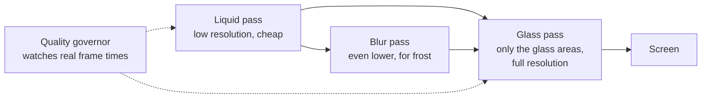

# SplitX web: the Liquid Glass overhaul

**Status:** written 3 November 2026. Phases 0 and 1 are under way on the `feat/liquid-glass` branch. Your live site is untouched.
**The look we are building:** [SplitX Liquid Glass canvas](https://claude.ai/artifact/XSFNfEYYXmoVufit1w6w9B).
**The phone app** ([roadmap](../mobile/ROADMAP.md)) is paused until this ships.

## 1. The goal

Your live web app and PWA get the canvas design, on every page, and it must feel smooth on a real phone, not only on a laptop.

Your rules, from the design review:

- Apple-style liquid glass, with liquid floating behind it all the time.
- Everything centre-aligned and symmetrical.
- Only the theme colour you choose on the page.
- Settings let you choose the kind of glass, the colour, and dark or light, across the whole app.
- Plus Jakarta Sans everywhere.

Nothing about how the app works changes: same features, same API, same data. This is a change to how it looks and moves.

## 2. Why it lags, measured

Measured on your laptop's Intel UHD graphics, which is what the browser picked. The timing call itself costs 17.5 ms, which I measured and took off every number below.

| Rendering a phone-sized screen | At canvas size (0.33 MP) | At a real phone's resolution (2.5 MP) |
|---|---|---|
| Today's shader | 3.3 ms | **13.7 ms** |
| A rough two-step version | 2.4 ms | **6.3 ms** |

Reading the page layout costs 0.2 ms, so that isn't the problem. A frame must finish in 16.7 ms to hold 60 fps.

**This means two different things:**

1. **The lag you see on the canvas is mostly the canvas.** You had about 15 boards in view, all sharing one GPU connection and taking turns. At 3.3 ms each, one full round is about 50 ms, or about 20 fps per board. A real app shows one screen at a time, so this part disappears on its own.
2. **The real danger is phones.** 13.7 ms on your laptop's chip leaves almost nothing spare, and I expect a mid-range phone's graphics to be several times slower, which would mean about 20 fps or worse. That is an estimate. I can't measure a phone from here, so Phase 1 measures it on yours.

**The two-step prototype:** today every glass pixel recomputes the liquid up to six times. Instead, draw the liquid once at low resolution (0.6 ms in my test), then let the glass read from that picture. It leaves out the droplets and a few effects, so treat "twice as fast" as a first indication, not a promise. Phase 1 goes further by drawing only the glass areas at full resolution.

**Measured on the production engine (Phase 1), same chip, a 2.1 MP canvas:** about 2.2 ms per frame at full quality and 0.8 ms at the lowest, timed a little differently from the table above. Your phone is still the real test, and it hasn't run yet. Details are in `docs/DECISIONS.md`, D-119.

## 3. How the engine changes

The canvas engine proved the look. The production version keeps the look and changes how it draws.

**What it does:**

- **Three layers:** liquid at about a third of the resolution, a blur for frosted glass, and full-resolution drawing only where glass actually is. Most of the screen stops being expensive.
- **A quality governor:** it watches real frame times and quietly lowers resolution or effects before you can notice a stutter.
- **No more sharing tricks:** the canvas needed one GPU connection across many boards. A real page draws straight to its own canvas.
- **Pauses when it should:** in hidden tabs, off screen, and on request.
- **Recovers:** if the browser drops the GPU connection, the page falls back to CSS glass and rebuilds, so it can't go black.

**Quality levels, chosen automatically (Calm can also be chosen in Settings):**

| Level | Who gets it | What they see |
|---|---|---|
| Full | Fast phones, laptops | All of it at 60 fps or more |
| Balanced | Most phones | Same look, lower internal resolution, fewer rim effects |
| Calm | Slow phones, Reduced Motion, low battery, or by choice | A still picture of the liquid and CSS glass, no continuous animation |

This extends the `premium`, `balanced` and `calm` idea already in `usePerformanceMode.ts`.

**The hard technical problem: scrolling.** The browser moves page content on a separate thread from anything the engine draws. So a card drawn by the shader can lag a frame behind its own text while you flick, and that shows as a shaking rim. The canvas boards hardly scroll, so you haven't seen this.

**Changed during Phase 1.** Building it showed a simpler answer than giving each card its own canvas, and a problem with fixed things:

- **Scrolling cards use full shader glass, on one canvas that scrolls with the page.** The browser moves the canvas and the cards together, so a rim can't drift from its text. The canvas is taller than the screen, so a fast flick can't outrun it, and the engine moves it back into view on every frame.
- **Fixed things use CSS glass:** tab bar, top bar, sheets, the + button. The canvas sits beneath the page, so it can't cover text scrolling under a tab bar. `backdrop-filter` does cover it, with a real blur. Only two or three of these are on screen at once, so the cost is small.
- **So do cards in a sideways scroller,** such as Home's groups, because they move separately from the page.
- **The fallback is plain CSS glass** on everything, as before.

Your phone still has the final say. `/glass-lab` can switch between all of these. If this fails there, cards may end up simpler than on the canvas, and I'll show you before going further.

**Another trap:** 74 places use `backdrop-filter` today. Over a moving background, every one re-blurs on every frame, which is very expensive on phones. Most of them have to go.

**No new libraries, and the Content Security Policy doesn't need to change.** WebGL and locally served fonts are already allowed.

## 4. The design rules, applied to real code

**One colour.** 158 hard-coded colours in the code and most of the status colours move to the theme. Money uses brightness and its + or −, as on the canvas.

**One exception I recommend: red stays for errors and for destructive actions** such as Delete account, always with an icon and words. Someone about to erase their account should not see a pretty purple button. Tell me if you want this gone too.

**Centre alignment.** Page titles, numbers, cards, buttons and empty states all sit on the centre line. List rows mirror: picture, centred text, amount. The exceptions are chat bubbles (left and right show who spoke), long legal or help text, and the `/ops` tables.

**Desktop.** The wide layouts from D-117 stay, but they get a floating, centred glass top bar and centred content, as on the Website board.

**Your existing colours carry over.** The 16 palettes keep their IDs, so nobody's saved colour breaks.

## 5. Settings: the Appearance section

This replaces `settings/page.tsx`'s current Mode and Accent block, and the same controls open from the top-bar appearance button.

| Setting | Options | Saved |
|---|---|---|
| Kind of glass | Liquid, Frosted, Crystal, Tinted, Pearl, each button showing its own material | On this device, applied before first paint so there's no flash |
| Colour | The 16 palettes | As today |
| Mode | Light, Dark, Auto | As today |
| Motion | Full, Calm | New |

Every other settings row, button and dialog also becomes glass: profile, UPI ID, phone, export, sign out everywhere, delete account, install, sign out. Picking a colour plays the ripple across the page.

The phone's status bar colour and the installed app's splash also follow the theme where the platform allows it.

## 6. Every page, and what changes

Sizes are lines of code, showing where the work really is. "Shared" means it comes through the kit in Phase 3 with little page work.

| Area | Files (lines) | What changes |
|---|---|---|
| **App frame** | `(app)/layout` 622, `AppTopBar` 277, CSS 1,035 | Glass tab bar with sliding lens, + in the centre, floating top bar, glass drawer, liquid replaces `Ambient` and its emoji |
| **Settings** | `settings` 525, CSS 361 | Section 5 |
| **Home** | `dashboard` 414, CSS 678 | Hero orb with rolling balance, glass tiles, caught-style banner, group cards |
| **Groups** | `groups` 413, CSS 362 | Glass tile grid, search field, new group |
| **Group** | `groups/[id]` 860, CSS 386 | Hero, three actions, tabs with lens, centred bill rows, members |
| **Balance journey** | `journey` 375, CSS 349 | Glass timeline. `journey/print` 285 stays plain for paper |
| **New expense** | `transactions/new` 1,268, CSS 769, `SplitByItems` 663, voice 1,140 | Glass keypad and fields, split selector with lens, the liquid split moment. The biggest job |
| **Scan** | `scan` 687, CSS 598 | Glass camera controls and results |
| **Activity** | `transactions` 634, CSS 456 | Centred rows, glass filters and search |
| **Settle up** | `settlements` 739, CSS 428, `SettlementGraph` 1,033, UPI 469 | Liquid orbit map using the existing simulation, glass pay sheet, the all-settled moment |
| **Group chat** | `GroupChat` 695 | Glass bubbles and input. 60 inline styles to clean up |
| **Insights** | `analytics` 341, CSS 351, charts 176 | One-colour charts, glass cards |
| **Contacts, History, Receipts** | 581, 125, 278, CSS 293 | Shared, plus light page work |
| **Assistant, Alerts, Search** | 332, 305, 272, CSS 812 | Glass panels and sheets |
| **Tour, banners, offline** | 398, 107, 109 | Shared, plus light page work |
| **Landing page** | 13 files about 1,170, CSS 2,046 | Rebuilt around the bloom and liquid, centred. Second biggest job |
| **Sign-in pages** | 5 pages 633, `AuthKit` 196, CSS 418 | Welcome and Sign in boards |
| **Join and invite** | 173 | Shared |
| **Errors and offline page** | 206, `offline.html` | Glass, and working without the engine |
| **`/scale`** | 249, CSS 265 | Shared styling |
| **`/ops`, `/admin`** | about 1,160, CSS 527 | New colours and font only, as it's an admin tool |

**Inline style debt:** 385 inline styles, led by `SplitByItems` (70), `GroupChat` (60) and `VoiceOverlayPanels` (59). They ignore the theme until they're moved.

## 7. The phases

I stop and report after each phase. Times are working estimates that depend on your review speed, and I'll re-estimate after Phase 1, when the hardest unknowns are answered.

| # | Phase | Days | Finished when |
|---|---|---|---|
| 0 | Safe start | 1 | Branch, baselines, CI repaired |
| 1 | **Production engine** | 3–4 | Smooth on your actual phone |
| 2 | Foundations | 1–2 | New font, colours and glass setting work |
| 3 | Component kit | 2–3 | Every shared part is glass |
| 4 | App frame and navigation | 1–2 | Tab bar, top bar, liquid on every page |
| 5 | Settings | 1 | All of Appearance works |
| 6 | Core pages | 6–8 | All signed-in pages done |
| 7 | Public pages | 2–3 | Landing, sign-in, errors done |
| 8 | Motion pass | 1–2 | Transitions feel continuous |
| 9 | Hardening and release | 2 | Live on your site |

**Total: about 3 to 4 weeks.**

### Phase 0: safe start

- Work on a `feat/liquid-glass` branch. `main` deploys straight to your live site, so it stays untouched until Phase 9.
- Fix the CI release gate, whose k6 exceptions expired on 24 October.
- Take baseline screenshots of every page, phone and desktop, in both modes.
- Local test setup: production build, a throwaway database with fake users, and your phone over USB. No cost, no Docker.
- **Finished when:** all existing tests pass on the branch and the baselines are saved.

### Phase 1: production engine

Everything else depends on this, which is why it comes first.

- `src/lib/glass/` in TypeScript: the three layers, governor, recovery, and a `<Glass>` React component with CSS fallback.
- Test the scrolling problem on your phone and choose the approach for cards.
- A test page with Home's real content.
- **Finished when:**
    - It holds about 60 fps on your phone, measured there, and a slower phone drops a quality level instead of stuttering.
    - Scrolling shows no rim drift.
    - Losing the GPU connection never leaves a black screen.
    - It adds under 15 KB of JavaScript (compressed) and no new libraries.
    - The canvas can use the same engine, so its lag improves too.

**Where this stands (3 November):**

| Finished when | State |
|---|---|
| About 60 fps on your phone | Waiting for your phone |
| A slower phone drops a level | Unit tested, and seen working when I overloaded the laptop's GPU; not yet on a phone |
| No rim drift | Holds by how it is built; waiting for your phone |
| Losing the GPU never goes black | Done, tested on the laptop |
| Under 15 KB, no new libraries | Done: 11.2 KB of JavaScript plus 0.9 KB of CSS |
| The canvas uses the same engine | Not done. The canvas draws about 15 boards through one GPU connection, and this engine draws one page. Your real pages won't have that lag, so I'd drop this unless you want the canvas itself smoother |

### Phase 2: foundations

- Bundle Plus Jakarta Sans locally with its ₹ sign, as the current fonts are (D-116), so a build never waits on Google.
- Tokens from `glass.css` replace `tokens.css`, `themes/*` and `accents.css`, keeping today's variable names where pages rely on them.
- Extend `useTheme` and the first-paint script with glass kind and motion.
- Sweep the 158 hard-coded colours, with a test that fails if new ones appear.
- **Finished when:** every page, not yet redesigned, picks up the new font and colours with nothing broken, and all tests pass.

### Phase 3: component kit

- Rebuild `kit.tsx` (17 components), `Button`, `Input`, `Modal`, `Toast`, `Avatar`, `Skeleton`, `EmptyState`, `ErrorState`, `Icons`, `BrandMark`.
- Add `Toggle`, `GlassPicker`, `Row3`, `Keypad`, `Orb`.
- A development-only page shows them all, in every theme, mode and glass kind.
- **Finished when:** contrast passes for 16 colours × 2 modes × 5 glass kinds, checked automatically on the worst case of liquid behind the text. Every touch target is at least 44 px.

### Phase 4: app frame and navigation

- Glass tab bar with a sliding lens, floating top bar on desktop, drawer, and the liquid background replacing `Ambient`.
- **Finished when:** navigation feels right on phone and desktop, and the tour still points at the right things.

### Phase 5: settings

- Section 5. It comes early because you asked for it specifically, and it lets you try every kind of glass on the rest of the work as it lands.
- **Finished when:** every setting applies instantly across the app and survives a reload, with no colour flash.

### Phase 6: core pages

In this order, so the most-used screens get the most care: Home, New expense, Settle up, Group, Groups, Activity, Scan, Chat, Insights, then the rest in Section 6.

- **Finished when:** each page is compared with its canvas board and works in both modes. The Playwright flows still pass after each page. They find things by label and role, so keeping the same words keeps them working.

### Phase 7: public pages

- Landing, sign-in, errors, join, offline, `/scale`.
- **Finished when:** first load stays fast on a phone (measured against today's), and the engine loads only after the page is usable.

### Phase 8: motion pass

- Screen transitions, shared moves (a group card growing into its page), list entrances, rolling numbers, the split and settled moments, the theme ripple, haptics.
- `framer-motion` is in 51 files. Use CSS where it does the job, to reduce what the phone has to run.
- **Finished when:** interactions stay under 200 ms on your phone, and Calm mode has an equivalent for every effect.

### Phase 9: hardening and release

- Accessibility: Reduced Motion, screen readers, keyboard, zoom.
- A battery comparison against today's site over 10 minutes on your phone.
- The PWA installed on your phone, with new icon and splash.
- All tests, CSP checks and Sonar. Print still works.
- Merge to `main`, confirm the live site, and keep a one-step way back.
- **Finished when:** you've used it on your own phone and said yes.

## 8. Risks

| Risk | What we do |
|---|---|
| Too slow on budget phones | Quality levels, tested on real hardware in Phase 1, before anything depends on it |
| Battery drain from always-moving liquid | Liquid updates less often than the screen, pauses when hidden, drops to Calm on low battery, measured in Phase 9 |
| Rims drifting while scrolling | Tested first in Phase 1, with two fallbacks |
| Text hard to read over moving colour | Automated worst-case contrast check; glass thickens where needed |
| iPhone Safari differences | Tested in Phase 1 if you have access to an iPhone. Otherwise it's a known gap, and CSS glass is the safe default there |
| Breaking something during a 3–4 week change | Branch, tests after every page, live site untouched until the end |
| Existing users surprised | Their palette and mode carry over. Liquid glass is the new default |

## 9. What this does for the phone app

Most of this carries over: the design kit, the colour system, the shader's maths (the app's Skia renders the same kind of shader), every screen's layout, and the motion. The app's Phase 1 becomes much shorter, because the design question will already be answered in production.

## 10. What I need from you

1. **Your go-ahead** for Phases 0 and 1.
2. **Your phone:** brand, model, Android version. Phase 1's whole test is whether it runs smoothly on a real phone, so a USB cable to your laptop would help. A second, cheaper phone would be very useful. Do you have access to an iPhone?
3. **The red exception** in Section 4: keep it, or remove it?
4. **The branch rule:** your earlier rule was to push straight to `main`, but that would put half-built pages on your live site. Is the branch OK for this work?
